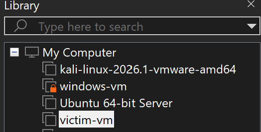
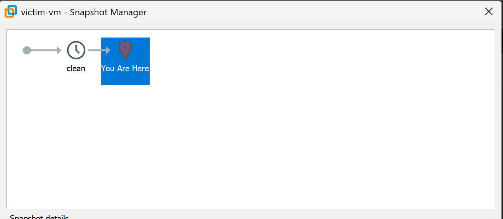

So, it seems that theres been a trend going on in local CTFs where forensics challenge author would accidentally leave sensitive files or links in their memory dump attachments. These could range from tracker google sheets links, internal github repo links, ~~slop~~ setup scripts, or even personal identity documents. Being a forensics author myself, I thought I would share my VM setup for developing forensics challenges. Although I'm relatively new on the CTF field, I think my setup is proper enough and it should prevent things like that from happening (its really nothing special lol). 

## My VMs
I used to use virtual box for my vms, but I've recently changed to vmware workstation pro. My setup, however, didn't change all that much. Here are all the base vms I have

- Kali is my main vm for simulating attacks. I run all my payloads, C2, and host malware there. I also occasionally use it for maldev when I need things like msfvenom revshell or shellcode.
- windows-vm is my main vm for doing windows malware analysis, especially dynamic analysis. Its equipped with various dynamic analysis tools such as x86dbg, wireshark, procmon, apimonitor, etc. I also use it to test any malware payloads I make before sending it to the "victim". ATM I do not have any VMs for linux malware analysis, which I should probably add.
-  Ubuntu 64-bit Server is my vm for when I need a linux machine for a victim, although I rarely use it as I usually do windows forensics
-  victim-vm is my vm for when I need a windows machine for a victim. It's actually a clone of the windows-vm as I want to make it as similar as my testing vm. I also never link anything "real" to this VM, this includes github account, google account, etc. If any accounts are needed, I'll make a throwaway account specifically for the vm. This prevents any files from my actual account from accidentally being included in any artifacts which is usually how the problem setters accidentally leave sensitive files on their artifact.

The majority of my maldev is done on my windows host as most of my programming tools are there. I use Bridged network adapter for all my VMs so that its easy for all of them to communicate with each other and with my host.

All my VMs have a snapshot on the "clean" state which is basically the state where I haven't tampered with anything except installing some tools and applying some configuration. For windows vm, its usually after I nuked defender.

Whenever I want to capture an artifact for a challenge, I usually always revert to the clean state before doing any simulation. This prevents any artifacts from testing being accidentally captured.

## Creating artifacts
I never use any setup scripts to simulate incidents or creating artifacts, mainly because it isn't realistic but also if you use those it's very difficult to make sure they don't accidentally get left behind in the artifacts. 

My usual workflow for creating artifacts is as follows:
1. Setup a python http server on my host to transfer any of my payload/malware that I develop on my host to my kali VM.
2. In order to transfer it, I usually simply use curl. If I need to transfer the malware to the victim before creating the artifacts, I'll also usually use curl. I try to never use browsers unless the browser is part of the challenge because you never know what could accidentally be saved on your browser cache.
3. Simulate the incident flow, which again I do manually.
4. Capture the artifacts.

When possible I try to capture the artifact from my host. For memory dumps, if you're using virtualbox you can follow the steps on [this](https://www.hackthebox.com/blog/how-to-create-linux-symbol-tables-volatility#mcetoc_1irpkuuf42l) HTB blog and if you're using vmware you can follow [this](https://medium.com/@fadilulahajeigbe01/vmware-lab-memory-forensics-using-volatility-4a696eef283c) blog. Although its worth noting that its better to give both the `.vmem` and `.vmss` file or use the [vmss2core](https://knowledge.broadcom.com/external/article/323788/converting-a-snapshot-file-to-memory-dum.html) tool. For disk dumps, you can open the vhd on FTK Imager then just dump want you need.

## Epilouge
Besides making sure your vm is sufficiently isolated from your host, you should also make sure to setup proper access control for any software/platform you use to organize your events. For example, if you're using google sheets to keep track of the challenge making process make sure that you do not set the visibility to everyone can view. You should instead only give access to whoever is in your team. Same thing with github repos, make sure your repo/organization isnt public.
